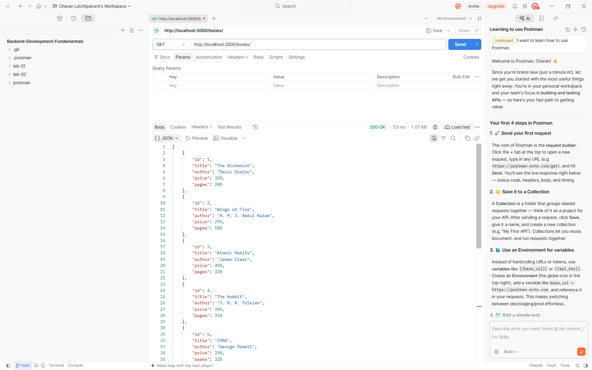
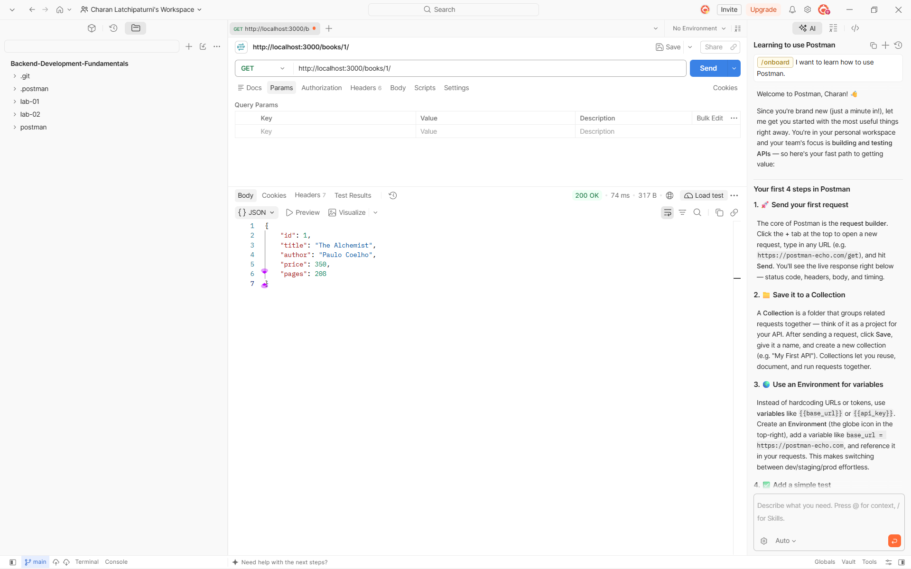
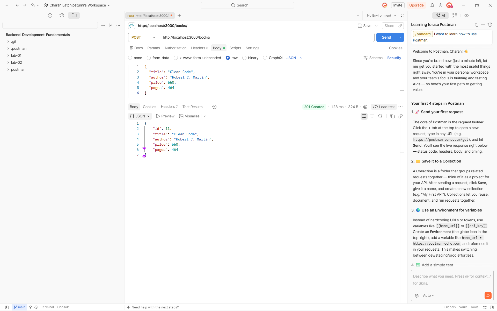
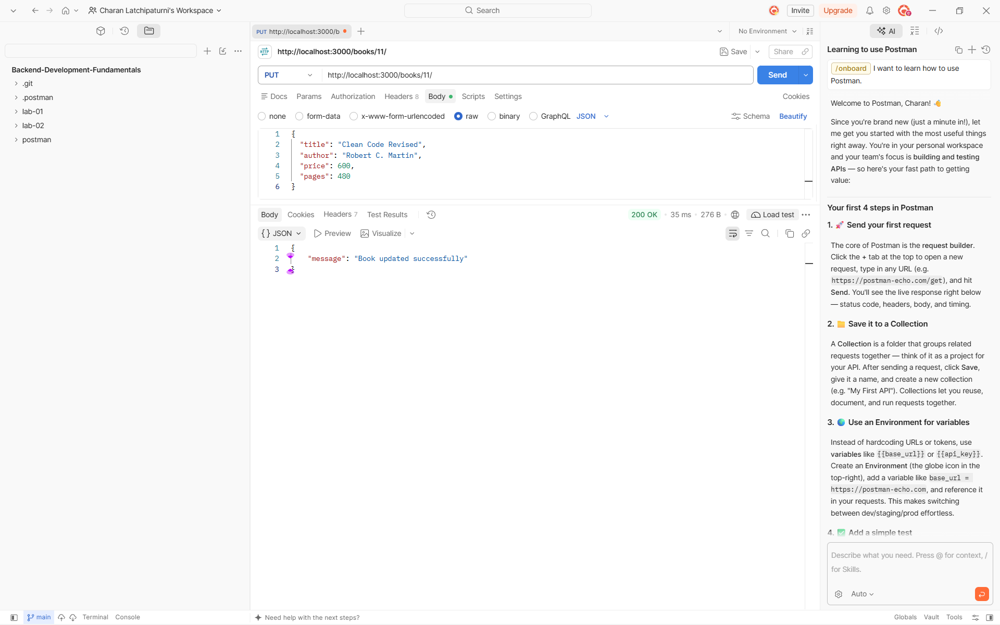
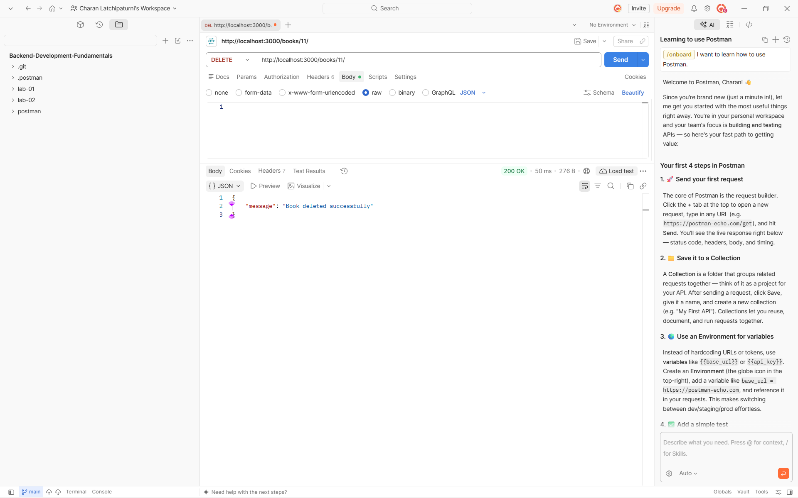
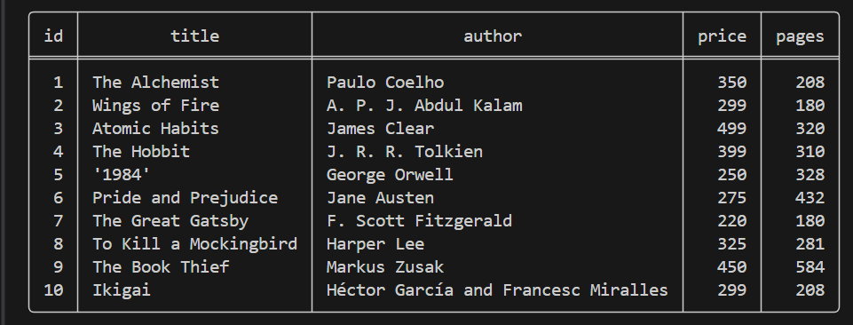

# Lab 2: SQLite database and CRUD routes

**Name:** P.Sai Kumar Reddy  
**Registration Number:** 252U1R8075  
**Class:** B.Tech CSE(QE) – 2B  
**Section:** S-13 204  
**GitHub Repository:** https://github.com/saikumarreddy4681-hub/backend_lab_2  
**Deployed Link:** https://backend-development-fundamentals-1-fzeu.onrender.com  

## Objective

Connect an Express server to a SQLite database and expose CRUD operations over HTTP.

## Technologies Used

- Node.js
- Express.js
- SQLite
- `sqlite` and `sqlite3`
- Nodemon
- Postman
- Render (Cloud Deployment)

## Project Setup and Execution

1. Open a terminal in the project folder.
2. Install the project dependencies:

   ```bash
   npm install
   ```

3. Start the development server:

   ```bash
   npm run dev
   ```

   Or run production server:

   ```bash
   npm start
   ```

4. The server runs at:

   ```text
   http://localhost:3000
   ```

## Database

The SQLite database is located at `database/books.db`.

The server automatically initializes the `database/` directory, creates the `book` table if it does not exist, and pre-populates it with 10 sample books if empty.

The `book` table contains the following columns:

| Column | Data Type | Description |
| --- | --- | --- |
| `id` | INTEGER | Primary key (Auto Increment) |
| `title` | TEXT | Book title |
| `author` | TEXT | Book author |
| `price` | INTEGER | Book price |
| `pages` | INTEGER | Number of pages |

The database was populated with 10 sample book records using the SQLite CLI and automatic database seeding.

## API Endpoints

| Method | Endpoint | Description |
| --- | --- | --- |
| GET | `/` | API status and root documentation |
| GET | `/books/` or `/books` | Retrieve all books |
| GET | `/books/:bookId/` or `/books/:bookId` | Retrieve a book by its ID |
| POST | `/books/` or `/books` | Add a new book |
| PUT | `/books/:bookId/` or `/books/:bookId` | Update a book by its ID |
| DELETE | `/books/:bookId/` or `/books/:bookId` | Delete a book by its ID |

For POST and PUT requests, send a JSON body containing `title`, `author`, `price`, and `pages`:
```json
{
  "title": "Clean Code",
  "author": "Robert C. Martin",
  "price": 450,
  "pages": 464
}
```

## Render Deployment Guide

This project is pre-configured for seamless deployment to **Render** (`render.yaml` included):

1. **Push to GitHub**: Ensure all files are pushed to `https://github.com/saikumarreddy4681-hub/backend_lab_2`.
2. **Create Web Service on Render**:
   - Go to [Render Dashboard](https://dashboard.render.com).
   - Click **New +** -> **Web Service**.
   - Connect the repository `backend_lab_2`.
   - Set the following configurations:
     - **Runtime:** `Node`
     - **Build Command:** `npm install`
     - **Start Command:** `npm start`
     - **Instance Type:** `Free`
3. **Environment Variables**:
   - `PORT`: Handled dynamically via `process.env.PORT || 3000`.
   - `NODE_VERSION`: `20.18.0` (configured in `render.yaml`).
4. **Deploy**: Render will build and start the service. You can visit the root URL `/` to verify that the API is running.

## Screenshots

### 1. Get all books



### 2. Get a book by ID



### 3. Add a book



### 4. Update a book



### 5. Delete a book



### 6. SQLite database records



## Problems Faced and Solutions

- The initial `package.json` file was empty. Added valid JSON before installing dependencies.
- The SQLite command-line tool was unavailable. Installed SQLite tools and verified the `sqlite3` command.
- Express was missing from the project dependencies. Installed it using `npm install express`.
- Render deployment requires dynamic port binding: updated server to listen on `process.env.PORT || 3000`.
- Ensured SQLite database and table auto-initialization so deployment on containerized platforms (like Render) runs smoothly without manual SQL setup.

## Notes

- SQL queries use `?` placeholders for user-provided values to prevent SQL injection.
- CORS is enabled to allow API requests from any client domain.
- Both trailing slash (`/books/`) and non-trailing slash (`/books`) routes are supported.
- The database connection is established before the Express server starts.
- `node_modules` and `.env` files are excluded from GitHub via `.gitignore`.
